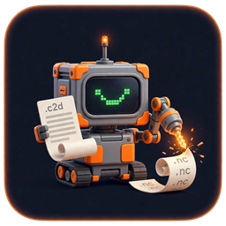
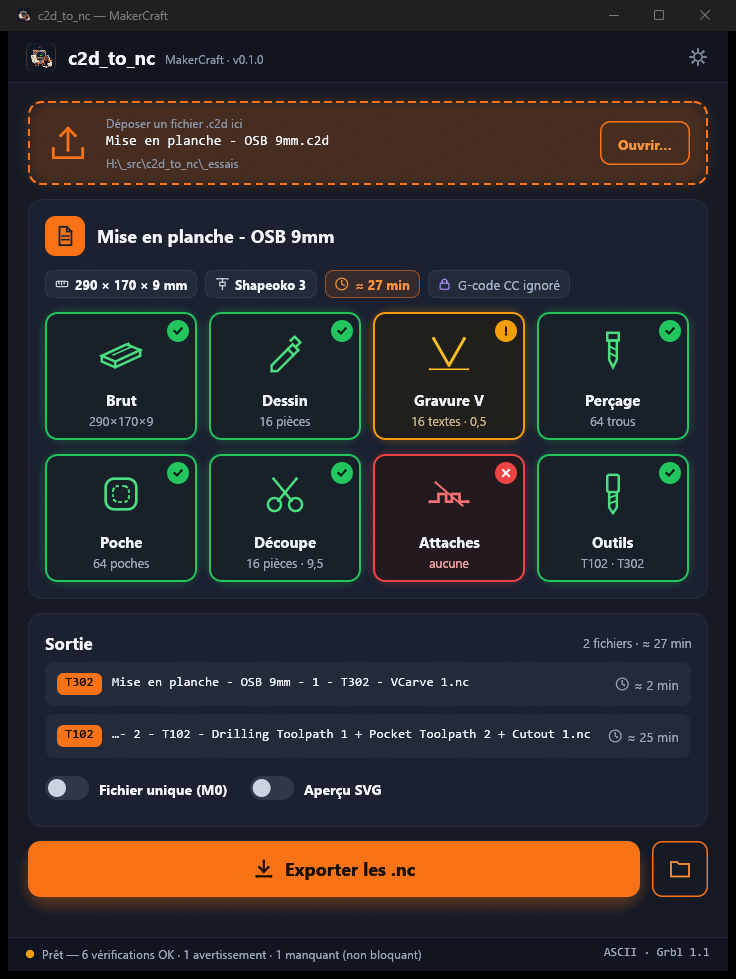
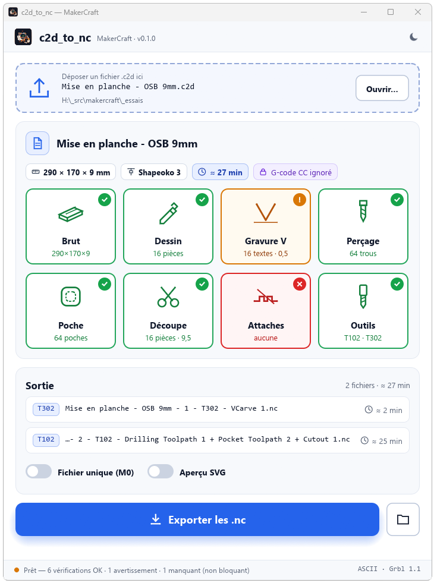
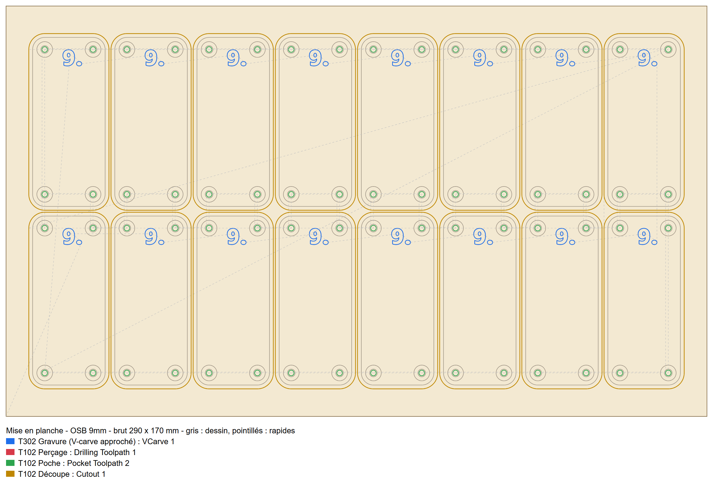

# c2d_to_nc



[](https://github.com/FeBeSoft/c2d_to_nc/actions/workflows/ci.yml)

Petite application de bureau : on glisse un projet Carbide Create (`.c2d`) dans la fenêtre,
elle vérifie son contenu et écrit le G-code Grbl (`.nc`) dans le même dossier que le projet.

Pensée pour le fablab et la classe : un coup d'œil suffit pour voir si le projet est prêt
(brut, dessin, parcours, outils, attaches), et le G-code produit s'envoie avec n'importe quel
logiciel de pilotage Grbl (Candle, Universal G-Code Sender, LaserGRBL, Carbide Motion…).

<table>
  <tr>
    <td></td>
    <td></td>
  </tr>
  <tr>
    <td align="center">Thème sombre</td>
    <td align="center">Thème clair</td>
  </tr>
</table>

> **Outil indépendant, non affilié à Carbide 3D LLC.** Carbide Create, Carbide Motion et
> Shapeoko sont des marques de Carbide 3D LLC. c2d_to_nc lit le format des fichiers de projet
> à des fins d'interopérabilité ; il n'utilise aucun code ni aucune ressource de Carbide 3D.

## Utilisation

- glisser un fichier `.c2d` dans la fenêtre, sur l'icône de l'exécutable, ou cliquer sur « Ouvrir… » ;
- lire les tuiles : vert = prêt, orange = avertissement, rouge = manquant ; le détail
  s'affiche au survol ;
- choisir les options de sortie puis « Exporter les .nc ».

Sortie :

- **un fichier par outil** (par défaut), nommés `projet - 1 - T302 - VCarve 1.nc`, etc. ;
- ou **un fichier unique** avec une pause `M0` à chaque changement d'outil ;
- en option, un **aperçu SVG** des trajectoires.

Le G-code est du Grbl 1.1 en ASCII strict. Zéro : X0 Y0 au coin avant gauche du brut,
Z0 sur le dessus du brut. La durée affichée est une estimation, hors changements d'outil.

### Ce qui est recalculé

Le G-code que Carbide Create enregistre dans le projet est chiffré : c2d_to_nc ne le lit pas.
Il reprend le dessin, les outils et les réglages de chaque parcours, puis recalcule les
trajectoires lui-même.

| Parcours Carbide Create | Prise en charge |
|---|---|
| Découpe (contour) | oui, intérieur / extérieur / sur le trait, passes successives |
| Poche | oui |
| Perçage | oui, avec débourrage |
| V-carve | approché : gravure sur le trait à profondeur fixe (pas de V à profondeur variable) |
| Attaches (tabs) | non reproduites : un avertissement invite à brider les pièces |
| Autres types | ignorés, avec un avertissement |



<sub>Aperçu SVG des parcours recalculés pour le projet d'exemple (option « Aperçu SVG »).</sub>

**Vérifier le G-code dans un simulateur (Candle, NC Viewer…) avant d'usiner.**

## Compilation

Rust 1.95 ou plus récent (édition 2024).

```
cargo build --release          # target/release/c2d_to_nc(.exe)
cargo test
cargo clippy --all-targets -- -D warnings
```

Sous Windows, l'icône et les informations de version sont intégrées à l'exécutable si l'outil
de ressources (`rc.exe`, fourni avec Visual Studio Build Tools) est présent.

## Organisation

```
apps/c2d_to_nc/   l'application (egui) : interface, tuiles, thèmes sombre et clair
crates/ext/c2d/   lecture des projets .c2d (formes, calques, outils, parcours)
crates/ext/cam/   calcul des trajectoires et écriture du G-code Grbl
crates/core/      géométrie de base, contrat d'extension
assets/           icône de l'application
```

Les crates `makercraft-*` viennent du projet MakerCraft, dont c2d_to_nc est une application
autonome.

## Licence

GPL-3.0-or-later (voir [`LICENSE`](LICENSE)).
